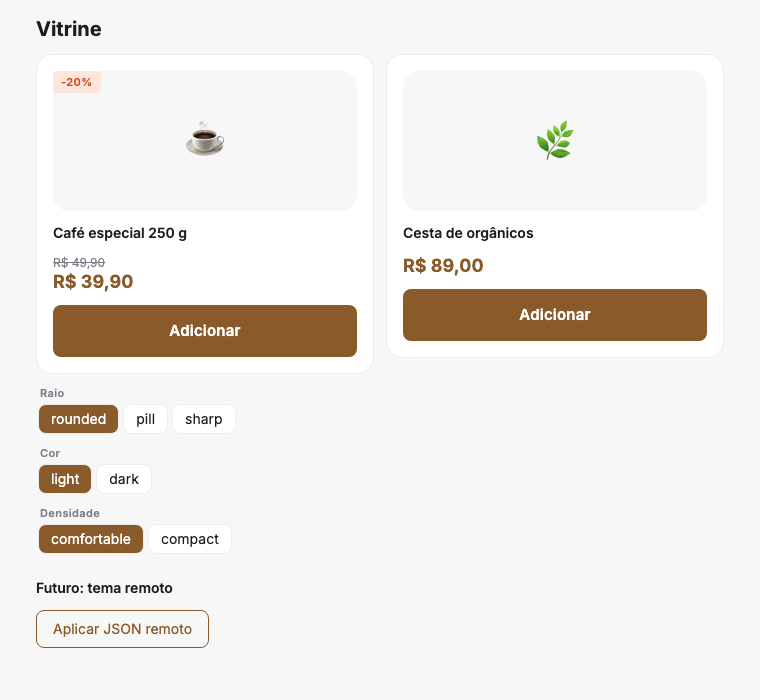
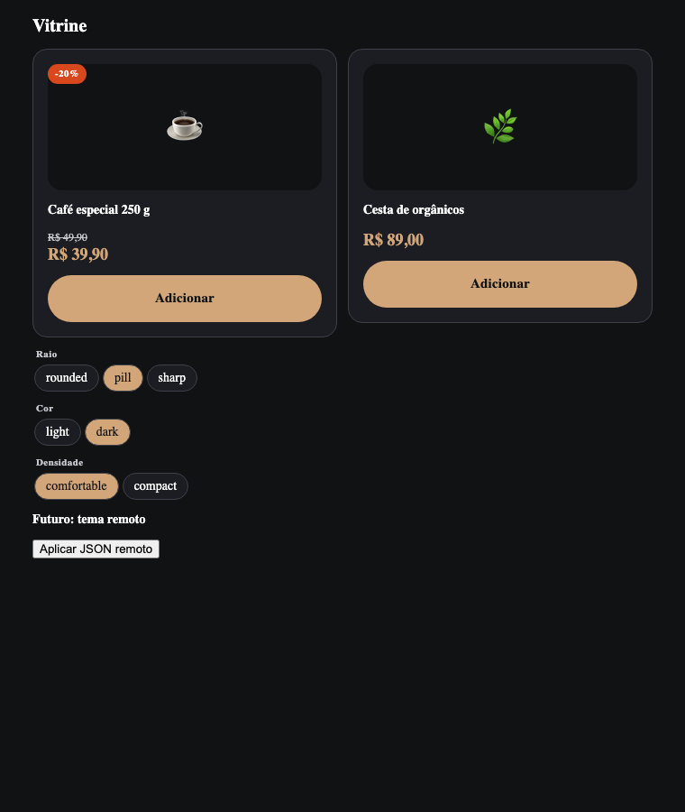
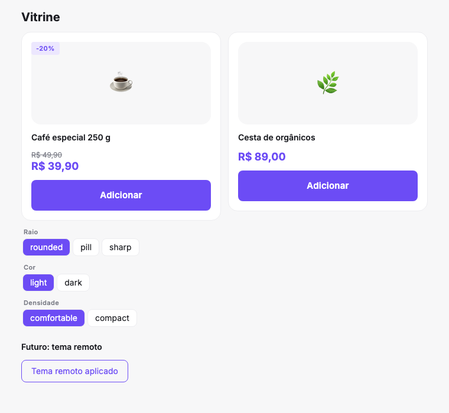
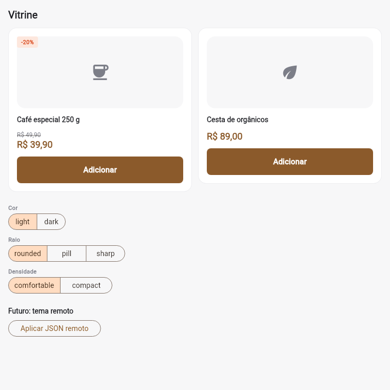

# Design Tokens Pipeline

Validação de um pipeline **Figma → código** para um produto de uma marca, com
React e Flutter, preparado para ter tema remoto no futuro.

| React · light | React · dark + pill | React · JSON remoto aplicado | Flutter · light |
|---|---|---|---|
|  |  |  |  |

## A ideia

```
Figma (Variables)
  │  export nativo — DTCG, um arquivo por mode
  ▼
tokens/figma/<coleção>/<mode>.json      ← versionado, revisado em PR
tokens/manual/typography.json           ← o que o Figma não exporta
  │  npm run tokens  (Style Dictionary resolve os aliases)
  ├──► apps/web/src/tokens/tokens.css    variáveis CSS por mode
  ├──► apps/web/src/tokens/tokens.ts     nomes tipados → var(--...)
  ├──► apps/flutter/lib/tokens/app_tokens.g.dart   ThemeExtension por coleção
  └──► build/remote/<coleção>.<mode>.json          payload para tema remoto
```

**Hoje** os valores vão compilados no app: autocomplete, erro de compilação
para token inexistente, nenhum parser em runtime.

**No futuro**, se precisar mudar o visual sem publicar na loja, nada nas telas
muda: o Flutter já tem `AppColorTokens.fromJson(...)` e a web já tem
`applyRemoteTokens(...)`, os dois lendo o mesmo JSON de `build/remote/`.

## Comandos

```bash
npm install
npm run tokens          # gera CSS, TS, Dart e os JSONs remotos
npm run tokens:check    # CI: falha se o código gerado estiver desatualizado
npm test                # testes do pipeline

cd apps/web && npm install && npm run dev       # ?color=dark&borderRadius=pill abre direto num mode
cd apps/flutter && flutter run
```

## Atualizando a partir do Figma

1. No Figma, abra **Variables** e exporte cada coleção (o export nativo gera
   um JSON DTCG por mode).
2. Salve como `tokens/figma/<coleção>/<mode>.json` — ex.:
   `tokens/figma/color/dark.json`.
3. `npm run tokens` e abra o PR. O diff dos arquivos gerados mostra exatamente
   o que mudou no visual.

Coleção com mais de um mode precisa do mode padrão em
`tokens/tokens.config.json → defaultModes`: o arquivo exportado não diz qual é.

> Os arquivos de `tokens/figma/` deste repositório foram gerados pelo
> conversor do `design_system_mvp`, no formato do **Import** do Figma. O passo
> que ainda falta validar é trocar esses arquivos por um **export real** e ver
> se `npm run tokens` passa sem ajuste.

## Usando os tokens

**React** — o valor é uma referência CSS, então trocar de mode não re-renderiza nada:

```tsx
import { tokens, applyTokenMode } from './tokens/tokens';

<button style={{
  ...tokens.typography.button.label,
  background: tokens.color.component.button.primary.background,
  borderRadius: tokens.borderRadius.component.button.primary,
}} />

applyTokenMode('color', 'dark');   // <html data-color="dark">
```

**Flutter** — cada coleção é um `ThemeExtension`, com uma instância `const` por mode:

```dart
ThemeData(extensions: appTokenExtensions(color: AppColorTokens.dark));

Container(
  color: context.colorTokens.componentProductCardSurface,
  padding: EdgeInsets.all(context.dimensionTokens.componentProductCardPadding),
);
```

O `MaterialApp` anima a troca de tema usando o `lerp` gerado.

Nos dois lados, `componentProductCardSurfaec` (com erro de digitação) **não
compila** — o TypeScript ainda sugere `Did you mean 'surface'?`.

## Decisões

| Decisão | Por quê |
|---|---|
| Fonte de verdade em DTCG (padrão W3C) | É o que o Figma exporta nativamente; não depende de plugin |
| Prefixo da coleção em todo token | `component/productCard/surface` existe em `color` e em `borderRadius`; sem prefixo, colidem |
| Cada mode resolvido num dicionário separado | `color.dark` resolve com `primitives` no padrão sem misturar com o light |
| `primitives` e `font` ocultas na saída | Componentes usam tokens semânticos e de componente; primitivo direto no código não compila |
| Dart gerado com `// dart format off` | Formatação do time não pode fazer o `tokens:check` acusar diferença |
| Código gerado versionado | O diff do PR mostra o impacto visual; o app compila sem rodar o pipeline |
| `fromJson` com fallback por campo | Tema remoto parcial (só as cores que mudam) funciona; valor inválido é ignorado |

## Comparando com o `design_system_mvp` (runtime, estilo Umami)

| | MVP runtime | Este pipeline |
|---|---|---|
| Acesso a token | `color('component/card/surface')` | `colorTokens.componentCardSurface` |
| Nome errado | Fallback magenta em runtime | Erro de compilação |
| Parser, resolver, cache no app | Sim | Não (só no build) |
| Tema remoto | Pronto | Pronto para ligar (`fromJson` / `applyRemoteTokens`) |
| Várias marcas | Natural (troca o JSON) | Possível, mas tudo embarcado |
| Web | Precisaria de um parser em JS | Variáveis CSS nativas |

## Limitações conhecidas

- **Tipografia** fica em `tokens/manual/` porque o export nativo do Figma não
  inclui Text Styles. Ela referencia as variables da coleção `font`, que vêm do Figma.
- **Decoração de texto** (riscado do preço antigo) não existe no DTCG
  `typography`; é aplicada no componente.
- **Fontes no Flutter**: a Inter não está embarcada — o app usa a fonte do
  sistema. Adicione os arquivos no `pubspec.yaml` ou use `google_fonts`.
- **Unidades na web**: todo `number` vira `px`, exceto nomes que casam com
  `unitlessTokenPatterns` (hoje, `weight`). Opacidade ou proporção exigiriam
  incluir o padrão ali.
- **CI** em `.github/workflows/tokens.yml` foi escrito, mas não executado.
